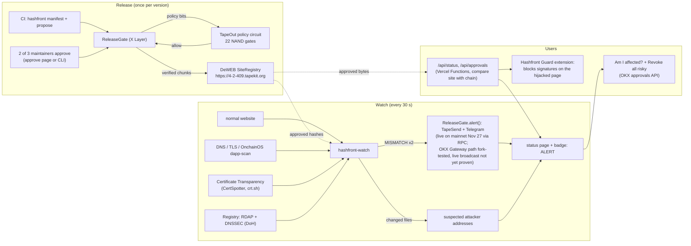

# Hashfront

[](https://github.com/syther069/hashfront/actions/workflows/ci.yml) · MIT · Built for X Layer TapeOut Accelerate (Build X Series)

**When a DeFi frontend gets hijacked, Hashfront catches it in under a minute, warns users on Telegram and on chain, and keeps a copy of the approved app that the attacker cannot touch.**

> **Success metric:** hijack to onchain alert in **under 60 s** (measured on mainnet: 51 s in the [rehearsal](docs/evidence-hijack-rehearsal.md), 44 s in the [Nov 27 live run](docs/evidence-okx-gateway-alert.md)) · watching: **8 h, 960 checks, 100 % schedule uptime, one declared drill, 0 alerts outside it** ([`docs/metrics.md`](docs/metrics.md)); one run is too little to claim a false-alarm rate · detection still works **with OKX down**.
>
> The minute is for a **changed website**. Certificate and registry changes (new certificate, nameservers, DNSSEC) are polled about every 10 minutes, so those alerts can take that long; DNS changes are checked on every pass.

Live: [status page](https://hashfront-status.vercel.app) · [verified copy](https://4-2-409.tapekit.org/) · [protected demo site](https://hashswap-demo.vercel.app)

Every frontend release is approved by maintainers through a **TapeOut policy circuit on X Layer**. It is stored byte for byte on **DeWEB**, and a watcher compares the normal website with that onchain release around the clock. When the two differ, alerts go out over **TapeSend** (on chain) and Telegram, and users open the verified copy instead.

## The problem, with numbers

An attacker doesn't need to touch the contracts. They take over the domain at the registrar or DNS host and serve an identical-looking app that asks the wallet for an unlimited approval to their address.

| When | What happened | Loss | Source |
|---|---|---|---|
| Oct 30-31, 2026 | Name.com registrar hijack: 12 DeFi sites taken over at once and sent to a drainer (Name.com later confirmed 15 domains) | about $138K | [The Block](https://theblock.co/news/defi/2026-10-31-hackers-hijack-a-dozen-defi-websites-all-registered-with-name-com-and-steal-about-138000-432251), [Crypto Briefing](https://cryptobriefing.com/name-com-restores-hijacked-defi-domains/), [Forklog](https://forklog.com/en/news/hackers-hijack-domains-of-15-defi-projects) |
| Nov 21-22, 2025 | Aerodrome and Velodrome domains hijacked; one preliminary report says DNSSEC was removed | one report: about $700K | [The Block](https://www.theblock.co/news/ecosystems/2025-11-22-top-dexs-aerodrome-velodrome-hit-with-front-end-compromise-urge-users-to-avoid-main-domains-380037), [Blockaid](https://www.blockaid.io/blog/how-blockaids-customer-data-network-contained-the-aerodrome-dns-attack) |
| Feb 16-23, 2026 | Five DeFi frontends compromised in one week (OpenEden, Curvance, Smithii, Avantis, Nerochain); OpenEden's domain was moved between registrars | not totalled | [Blockaid](https://blockaid.io/blog/frontend-hijacking-and-the-web2-attack-surface-threatening-web3-protocols) |
| earlier | eth.limo hijack through a social-engineering breach at EasyDNS | n/a | [The Block](https://www.theblock.co/amp/post/398005/easydns-accepts-responsibility-for-eth-limo-hijack-its-first-social-engineering-breach-in-28-years) |

Figures are as the sources report them; the root causes are still partly unsettled in the press (for the Aerodrome case the DNSSEC detail comes from one preliminary account, and the $700K from one report). We state what they say and no more.

Users can't see the difference, and teams usually find out from their users.

## Who uses it, and who pays

- **Users:** a DeFi protocol team (a named persona comes from the D3 interviews) and the people who use its frontend.
- **Payer:** the protocol. X Layer protocols get a free tier with a self-hosted watcher. A hosted watcher plus a second vantage point plus the guardian pause is the paid plan (for example $99-299 per month).
- The reasoning, with loss per incident against price, is in [`docs/business.md`](docs/business.md).

## Alternatives vs Hashfront

| | Detects a hijack | Warns users | Gives a safe copy | Gap |
|---|---|---|---|---|
| **Blockaid** | at the wallet, per transaction | in the wallet | no | after the fact; the user must already use a protected wallet |
| **DNSspy, CertSpotter, Cloudflare notifications** | DNS or certificate changes only | the site owner only | no | no content check, no users, no safe copy |
| **Autark** (multisig, ENS/IPFS releases) | no watcher | no | yes (IPFS) | nobody compares the live site with the release |
| **IPFS CID verification** | only if the user checks | no | yes | users never check |
| **Hashfront** | content, DNS, certificate, phishing scan | Telegram and onchain TapeSend | yes, from chain (DeWEB) | detect, warn and recover in one flow |

## Why a TapeOut circuit, not just a Safe

- **The policy is inspectable data, not code you have to trust.** The 22-gate netlist is stored on chain, and the status page reads it and evaluates all 32 rows in your browser against the gate. Anyone can run `eval(4, bits)` from any address ([`circuits/README.md`](circuits/README.md), fork-tested in `contracts/test/fork/PolicyReuse.t.sol`).
- **The policy is reusable.** Any contract can evaluate circuit #4 with no TapeOut fee or permission (gas only). On a fork, a second gate shipped a release under #4's rule; its alerts and migration need its own circuit token, so `hashfront init` tapes out a byte-identical copy per project and checks all 32 inputs before it spends anything else.
- **One small circuit decides it.** Freeze, timelock and the 3-of-3 hotfix path are 5 inputs to one function, instead of flags spread across a contract.
- **It is the same token as the site.** The circuit NFT the gate holds also owns the DeWEB container, so the policy that allows a release is the only thing that can change the verified copy.
- **What it is not:** the same rule could be written in Solidity. The circuit adds no power Solidity lacks. What it adds is that the rule is public, stored data that the gate, the status page and other projects all run as is. The deployed gate can't swap its policy (`policyId` is immutable); the v2 design that separates the two is in [`circuits/README.md`](circuits/README.md).

## Where TapeOut is used

| Feature | TapeOut piece | Contract / ID (X Layer) | What breaks without it |
|---|---|---|---|
| A release goes live only under the policy | Policy circuit (TAP-02 netlist), evaluated by the processor | circuit #4 on processor #409 `0x39E4…84D0` | The rule would be contract code, not stored data that the status page and other projects run as is |
| The approved release, byte for byte | DeWEB SiteRegistry (TAP-10), written only by the gate | container `0x5D96…92bA` in registry `0xd6EF…ADB6` | The watcher has nothing trustworthy to compare with |
| The verified copy users open during a hijack | DeWEB gateway, canonical name | `4.2.409.tape` → https://4-2-409.tapekit.org/ | No safe place to send users |
| The onchain alert and all-clear | TapeSend (TAP-10 hub), sent as the site's own container with fixed text | hub `0xe61A…25ee` | Only Telegram: no public onchain record of the alert |
| Alerts in another project's inbox | TapeSend endpoint ids; up to 8 inboxes per alert, about 100k extra gas each (fork-measured) | `--tapesend-to self,<endpoint id>`; the status page computes the id from a container address | Other TapeOut projects would have to poll our status page |
| Who may change the site | The circuit NFT (one token: policy + container + TapeSend identity) | held by ReleaseGate `0xAF96…80F6` | The site owner key could bypass the gate |

Not TapeOut, but X Layer: the Builder Code `15ld85k6825od6yr` (ERC-8021) on our transactions, and the OKX Onchain OS APIs (see "Built on OKX Onchain OS").

TapeSend is an onchain record delivered to subscribed TapeSend identities. It is not a push to every user: reading an inbox needs your own DeWEB container.

## Honest limitations

- **Content-integrity monitoring is not new.** What is new here is the combination: an onchain release policy, a verified fallback copy on DeWEB, an onchain alert, and the attacker's addresses named from the approved bytes.
- **Our live demo is a hosting compromise, not a DNS hijack.** We do not own a domain, so the demo deploys a bad build to the protocol's `*.vercel.app` host. Certificate Transparency, registry and DNSSEC signals cannot show a hijack on a shared `vercel.app` certificate and are tested on recorded responses only.
- **Address extraction is best-effort triage.** Addresses that are obfuscated or fetched at runtime are missed.
- **A user-side guard protects only users who installed it.** It is a reference for wallets to read the same feed.
- **One vantage point.** The watcher sees what its own network sees. A hijacker who serves the real page to the watcher is caught only through the DNS and certificate signals.
- **One onchain alert text covers several causes.** A new certificate, a registry change and a DNS change all open the same incident and send alert kind 2, whose fixed onchain text says "domain records changed". The team's Telegram notice names the real cause. The text lives in the deployed gate and cannot change without a redeploy.
- **The guardian pause is an experiment, and fork-only.** `contracts/src/DemoVault.sol` and `--guardian-call` show a protocol letting one narrow key pause its own contract when an incident is confirmed (once per incident; only the owner unpauses). The watcher refuses it on X Layer mainnet, because one false positive pausing a live protocol is a liability. It is not deployed anywhere.
- **Batch revoke may ask for an EIP-7702 upgrade.** Tested with a real OKX Wallet on X Layer: it revoked two approvals in one confirmation, but only after the wallet asked to upgrade the account with EIP-7702 (with its own risk warning). The page says so, and the per-row Revoke button sends a plain approval of 0 with no upgrade. See [`docs/evidence-batch-revoke-okx-wallet.md`](docs/evidence-batch-revoke-okx-wallet.md).
- **Pricing is a hypothesis.** It is not validated by paying customers; see [`docs/business.md`](docs/business.md).

## Live on X Layer mainnet

| | |
|---|---|
| **Status page** | https://hashfront-status.vercel.app: live release, open alerts, and the full release policy, all read from chain in your browser |
| **Verified copy** (pin this) | https://4-2-409.tapekit.org/: HashSwap v1 served from chain by DeWEB; no server can change it |
| **Protected demo site** | https://hashswap-demo.vercel.app: "HashSwap", the normal website the watcher checks (release v2 live) |
| **ReleaseGate** | [`0xAF96CA14DB35420BF46b6Ab8feB513306B7D80F6`](https://www.oklink.com/xlayer/address/0xAF96CA14DB35420BF46b6Ab8feB513306B7D80F6) |
| **Policy circuit** | #4 on TapeOut processor #409 (`0x39E4…84D0`), held by the gate |
| **Site container** | `0x5D96417d287f6F10979b63b80504926DE4CE92bA`, name `4.2.409.tape` |

## What Hashfront does about it

Hashfront closes four gaps:

1. **Know:** a watcher compares every file the normal site serves with the release approved on chain. It also watches DNS, the TLS certificate, the registry (nameservers, transfer locks, DNSSEC through RDAP and DoH) and the OnchainOS phishing scan. Certificate Transparency (a new certificate for the domain) is best effort: in our 8 h run, without an API key, the public CT APIs were unavailable in 72 % of checks ([`docs/metrics.md`](docs/metrics.md)). The watcher now sends a CertSpotter API key when `CERTSPOTTER_API_KEY` is set, and after a rate limit (HTTP 403 or 429) it skips CertSpotter for 30 min instead of asking again every 10.
2. **Warn:** one alert per incident on Telegram and as an onchain TapeSend message. The text is fixed in the contract and has no links, so a stolen alert key can't send anyone to a phishing page. The status page and the embeddable badge turn red, and the team gets the **suspected attacker addresses**: addresses that appear in the served files and in none of the approved release's files (best-effort triage).
3. **Stop the signature:** the [Hashfront Guard](apps/guard) browser extension reads the same status feed (`/api/status`) and blocks wallet signatures on the hijacked page, before the user signs. It only protects people who installed it; the feed is also what a wallet could read.
4. **Recover:** during a hijack, users open the pinned verified link and get the exact approved bytes from chain (DeWEB). "Am I affected?" lists their X Layer approvals, ranks the attacker's address first, and **Revoke all risky** removes them in one wallet confirmation when the wallet supports EIP-5792, or one by one when it does not.

## Proof: hijack rehearsal on mainnet (Nov 20, 2026)

We "hijacked" our own demo site. The copy looked the same, but the Swap approval went to `0xBAd0…0Bad`. Full timeline: [`docs/evidence-hijack-rehearsal.md`](docs/evidence-hijack-rehearsal.md).

| UTC | |
|---|---|
| 09:49:32 | hijacked build deployed to `hashswap-demo.vercel.app` |
| 09:49:53 | watcher: **MISMATCH** (21 s); `index.html` changed, approved bundle missing |
| 09:50:23 | alert confirmed on a second check: Telegram + TapeSend [`0xc9d874f5…`](https://www.oklink.com/xlayer/tx/0xc9d874f5aa9fbf15640f2ff02987172fdc776782e5f9c3b3f6b326286296740b) |
| 09:50:40 | status page: "Open alert: website mismatch"; badge: ALERT; verified copy still served the real router `0xA1DA…` |
| 09:51:30 | real build restored, no duplicate alerts in between |
| 09:52:53 | all-clear after 3 clean checks: Telegram + TapeSend [`0xe40bbd20…`](https://www.oklink.com/xlayer/tx/0xe40bbd201b7757eee89080e30a53a670be6cbedb2d6e32c5bbfe086ad5939cb4) |

Both alerts together cost 0.0000092 OKB.

**With a real wallet** ([`docs/evidence-wallet-pass.md`](docs/evidence-wallet-pass.md)): a maintainer approved release v2 from OKX Wallet on the approve page. That transaction is [`0x1024923a…`](https://www.oklink.com/xlayer/tx/0x1024923ab8854aa45dcc44e10a7c56c2a5b1de77f7c868bacf9e9b576179df1b) and carries Builder Code `15ld85k6825od6yr`. A user then sent a swap approval from the verified DeWEB copy: [`0xf8bbeef5…`](https://www.oklink.com/xlayer/tx/0xf8bbeef560e447e0806ebec63db293631078cb0862c930e80ef630f5da367d97).

## Built on OKX Onchain OS

Hashfront uses OKX's APIs on X Layer for the parts where a hijack hurts most. Details and live results: [`docs/evidence-okx-api.md`](docs/evidence-okx-api.md).

| | OKX API | What it does for users |
|---|---|---|
| **Am I affected?** | Security: approvals | During an alert, users paste their address and see every X Layer token approval. The ones not to the protocol's contracts are flagged (plain wallet, unlisted, or flagged by OKX), with a one-click revoke |
| **Approve with a second opinion** | Security: transaction scan | A maintainer sees OKX's pre-execution scan of the exact `approve` transaction before signing; a warning must be acknowledged |
| **Alerts that get through** | Onchain Gateway: simulate, gas price, broadcast, orders | The alert path simulates with OKX, prices with the gateway, and broadcasts the same signed bytes through OKX and the RPC (so never a double alert). **Tested against a mock gateway on a fork and with live read-only calls.** The live mainnet hijack on Nov 27 sent its alert 44 s after the hijack went live (TapeSend tx [`0xba9c1079…`](https://www.oklink.com/xlayer/tx/0xba9c1079a9a0513a7a96eb4b49db8c2cdf41325d30962daa441a29211bf2bc6a)), but the watcher ran without OKX keys, so that alert went **over the plain RPC path, not the gateway** (no OKX order id). A live broadcast through the gateway is still to be proven ([evidence](docs/evidence-okx-gateway-alert.md), [runbook](docs/RUNBOOK-hijack-e2.md)) |
| **Never out of gas** | Balance + Gateway gas price | The watcher warns the team before the reporter wallet can't pay for 3 alerts |
| **Phishing signal anywhere** | Security: dapp-scan | The domain blacklist check runs over REST, so it also works in GitHub Actions |
| **Costs in dollars** | Market: price | Fees on the status page, the approve page and `hashfront init` show OKB and USD |

Keys stay server side (Vercel encrypted env, GitHub secrets, or a hidden prompt), never in the browser. Every OKX call has a fallback, so an OKX outage never stops detection or alerts.

## How it works



- **Release policy, enforced by a circuit on X Layer.** `allow = NOT frozen AND ((timelock passed AND 2 of 3 approved) OR 3 of 3 approved)`. The gate passes 5 input bits to the TapeOut processor and only activates a release if the circuit returns 1. The status page reads the stored netlist, evaluates all 32 rows in the browser, and cross-checks them against the gate.
- **Every byte is approved.** The manifest has one Merkle leaf per 24 KB chunk, binding path, content type, file hash, index and chunk hash. The gate recomputes `sha256(chunk)` on chain, so a leaked CI key can't upload anything the maintainers didn't approve.
- **The gate owns the site.** The policy circuit's NFT, and with it the DeWEB container, is held by `ReleaseGate`. Only an approved, activated release can change what the verified link serves.
- **Alerts come from the protocol's own identity.** `alert()` sends a TapeSend message from the site container. It also records `lastAlert`, so pages can show an open alert without scanning logs.

## Tech used

| | How Hashfront uses it |
|---|---|
| **X Layer** (chain 196) | all contracts and transactions; OKB gas (about 0.02 gwei); X Layer Builder Code `15ld85k6825od6yr` (ERC-8021) appended to every CLI, watcher and web transaction |
| **TapeOut** | the release policy is a taped-out NAND circuit (`circuits/`, TAP-02); the gate evaluates it for every activation |
| **DeWEB / TapeKit** | releases are stored in the SiteRegistry under the circuit's container; the `.tape` name serves the verified copy |
| **TapeSend** | onchain alerts through the DeWeb Hub, sent by the gate as the site's container |
| **OnchainOS** | `security dapp-scan` is one of the watcher's signals (phishing blacklist); approvals, transaction scan, gateway, balance and price are used as listed above |
| **Public data** | CertSpotter and crt.sh (Certificate Transparency), RDAP through rdap.org, and Cloudflare DNS over HTTPS for DNSSEC; each is asked only about the domain we watch, and a failure never blocks detection |
| **Stack** | Solidity 0.8.28 + Foundry · TypeScript on Node 24 (native type stripping) · viem, ox · React 19, wagmi, Vite · Playwright |

## Repository

| Path | What |
|---|---|
| [`contracts/`](contracts) | `ReleaseGate.sol` (approve → upload → seal → timelock → activate, freeze, cancel, key rotation, migrate, alerts) and the deploy scripts |
| [`circuits/`](circuits) | TAP-02 netlist builder and evaluator, and the policy circuit with its [truth table](circuits/out/truth-table.md) |
| [`packages/cli/`](packages/cli) | `hashfront`: `init` (one-command onboarding), `preflight`, the release flow, `status`, `verify`; signs with Foundry keystores; [GitHub Action template](packages/cli/templates/hashfront-release.yml) |
| [`packages/watcher/`](packages/watcher) | `hashfront-watch`: content comparison, DNS, certificate, Certificate Transparency, registry (RDAP, DNSSEC) and OnchainOS signals, suspected attacker addresses, incident state machine, Telegram and TapeSend alerts, per-check timings |
| [`docs/design-system.md`](docs/design-system.md) | the design system of the status page, approve page and Guard: tokens, rules and how they are measured |
| [`apps/web/`](apps/web) | status page (suspects card, watcher health, "Am I affected?" with batch revoke), maintainer approve page, the embeddable badge, and the Vercel Functions `/api/approvals`, `/api/suspects`, `/api/status`, `/api/tx-scan`, `/api/price` |
| [`apps/guard/`](apps/guard) | Hashfront Guard: Manifest V3 extension that blocks wallet signatures on a hijacked site ([limits](apps/guard/README.md)) |
| [`apps/demo-dapp/`](apps/demo-dapp) | HashSwap, the demo protocol frontend (plus the hijack copy used in the rehearsal) |
| [`scripts/`](scripts) | wallet and watcher runners, `metrics-report.ts` (watcher log to [`docs/metrics.md`](docs/metrics.md)), `pack-guard.ts` |
| [`docs/`](docs) | deploy runbook, rehearsal and wallet evidence, OKX API evidence, metrics, business case, interviews, demo script |

## Run it yourself

```bash
npm install
npm run typecheck && npm test                  # TypeScript and unit tests (circuits, CLI, watcher, web)
cd contracts && forge test                     # unit, fuzz and compatibility tests, plus read-only X Layer fork tests
```

Check the live deployment, with no keys needed:

```bash
node packages/cli/src/main.ts status --gate 0xAF96CA14DB35420BF46b6Ab8feB513306B7D80F6
node packages/cli/src/main.ts verify --id 1 --manifest manifests/v1.json --gate 0xAF96CA14DB35420BF46b6Ab8feB513306B7D80F6
node packages/watcher/src/main.ts --site https://hashswap-demo.vercel.app/ --gate 0xAF96CA14DB35420BF46b6Ab8feB513306B7D80F6 --manifests manifests --once
```

Protect your own frontend (the [CLI README](packages/cli/README.md) has the details):

```bash
hashfront preflight dist                        # relative paths, index.html, no server code
hashfront init --site https://app.example.org --maintainers 0xM1,0xM2,0xM3 \
  --uploader 0xCI --reporter 0xWATCHER --timelock 24h --build dist --account deployer --broadcast
```

`init` simulates unless you pass `--broadcast`. On mainnet it also asks you to type `DEPLOY`, shows the live fees first (about 0.082 OKB for a new circuit and its container), and never deploys twice for the same site.

## Tests

| Suite | Count | Covers |
|---|---|---|
| `forge test` | 62 (50 without the fork tests) | gate lifecycle, policy, fuzzing, manifest compatibility with the CLI, alerts, plus X Layer fork tests (contract holder on the real SiteRegistry, real TapeSend hub, the live circuit #4 evaluated by an unrelated address, a second gate on #4, one alert delivered to a second project's inbox) |
| unit (`npm test`) | 238 | circuit truth table, Merkle and manifest, preflight, keystore, init input, template guards; watcher compare, CDN and adversarial cases, DNS, certificate, CT, registry and scan signals, suspects, incident state machine, metrics report; OKX client and latency ring; web handlers and revoke logic; Guard request filter and verdict logic |
| end-to-end | CLI suites, watcher 9, web 15, Guard 9 (web and Guard also run in CI) | CLI on anvil and on a fork (`init`, Action sequence, demo release), watcher MATCH→MISMATCH, one alert per incident and the attacker address from a hijack build, Playwright on the status, approve and badge pages including suspects and revoke-all against a real anvil allowance, and the real extension loaded in Edge against the good and hijack builds |

## Security model and limits

- **What a stolen key can do:**
  - **Uploader (CI):** it can only stage bytes the maintainers approved.
  - **Reporter (watcher):** it can raise a false alarm or a false all-clear, never send users anywhere. A stolen reporter key can raise a warning banner, never block signing on a matching site: the Guard blocks only when the status server sees a mismatch now, or its own check of the page fails.
  - **One maintainer:** it can freeze or cancel, but not ship a release alone.
- **Rotation:** two maintainers can replace the third, the uploader or the reporter. All three can migrate the site to a new gate.
- **What the watcher can't do:** it sees one vantage point and needs the release manifests. "No open alert" means no alert was reported; it is not a live check, and a stopped watcher looks the same. A Cloudflare-modified page is reported as `CDN_MODIFIED` to the team and never shown as safe.
- **Trust assumptions:** TapeOut and DeWEB contracts are upgradeable by their operators, and the verified link depends on the tapekit.org gateway (or any TapeKit-compatible client) to render.

Built by [syther069](https://github.com/syther069).
