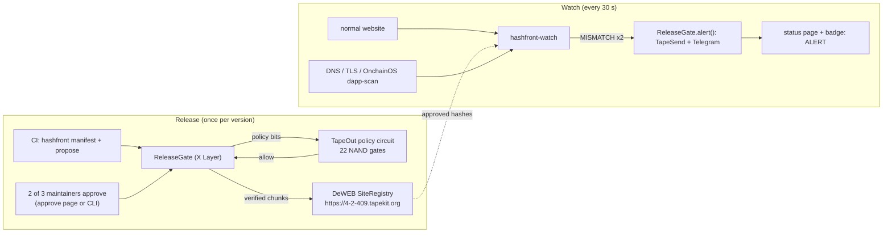

# Hashfront

[](https://github.com/syther069/hashfront/actions/workflows/ci.yml) · MIT · Built for X Layer TapeOut Accelerate (Build X Series)

**When a DeFi frontend gets hijacked, Hashfront catches it in under a minute, warns users on Telegram and on chain, and keeps a copy of the approved app that the attacker cannot touch.**

Every frontend release is approved by maintainers through a **TapeOut policy circuit on X Layer**. It is stored byte for byte on **DeWEB**, and a watcher compares the normal website with that onchain release around the clock. When the two differ, alerts go out over **TapeSend** (on chain) and Telegram, and users open the verified copy instead.

## Live on X Layer mainnet

| | |
|---|---|
| **Status page** | https://hashfront-status.vercel.app: live release, open alerts, and the full release policy, all read from chain in your browser |
| **Verified copy** (pin this) | https://4-2-409.tapekit.org/: HashSwap v1 served from chain by DeWEB; no server can change it |
| **Protected demo site** | https://hashswap-demo.vercel.app: "HashSwap", the normal website the watcher checks |
| **ReleaseGate** | [`0xAF96CA14DB35420BF46b6Ab8feB513306B7D80F6`](https://www.oklink.com/xlayer/address/0xAF96CA14DB35420BF46b6Ab8feB513306B7D80F6) |
| **Policy circuit** | #4 on TapeOut processor #409 (`0x39E4…84D0`), held by the gate |
| **Site container** | `0x5D96417d287f6F10979b63b80504926DE4CE92bA`, name `4.2.409.tape` |

## Why

Domain hijacks are one of the cheapest ways to drain DeFi users. The attacker doesn't touch the contracts. They take over the domain at the registrar or DNS host, then serve a copy of the app that looks identical but asks the wallet for an unlimited approval to their address. In the Oct 31, 2026 Name.com hijacks, 12 sites were taken over at once through their registrar. Users can't see the difference, and teams usually find out from their users.

Hashfront closes the three gaps:

1. **Know:** a watcher compares every file the normal site serves with the release approved on chain. It also watches DNS, the TLS certificate and the OnchainOS phishing scan, so a registrar hijack is caught even if the attacker shows the watcher the real page.
2. **Warn:** one alert per incident on Telegram and as an onchain TapeSend message. The text is fixed in the contract and has no links, so a stolen alert key can't send anyone to a phishing page. The status page and the embeddable badge turn red.
3. **Fall back:** every approved release lives on DeWEB under the protocol's own `.tape` name. During a hijack, users open the pinned verified link and get the exact approved bytes from chain.

## Proof: hijack rehearsal on mainnet (Nov 20, 2026)

We "hijacked" our own demo site. The copy looked the same, but the Swap approval went to `0xBAd0…0Bad`. Full timeline: [`docs/evidence-hijack-rehearsal.md`](docs/evidence-hijack-rehearsal.md).

| UTC | |
|---|---|
| 09:49:32 | hijacked build deployed to `hashswap-demo.vercel.app` |
| 09:49:53 | watcher: **MISMATCH** (21 s); `index.html` changed, approved bundle missing |
| 09:50:23 | alert confirmed on a second check: Telegram + TapeSend [`0xc9d874f5…`](https://www.oklink.com/xlayer/tx/0xc9d874f5aa9fbf15640f2ff02987172fdc776782e5f9c3b3f6b326286296740b) |
| 09:50:40 | status page: "Open alert: website mismatch"; badge: ALERT; verified copy still served the real router `0xA1DA…` |
| 09:51:30 | real build restored, no duplicate alerts in between |
| 09:52:53 | all-clear after 3 clean checks: Telegram + TapeSend [`0xe40bbd20…`](https://www.oklink.com/xlayer/tx/0xe40bbd201b7757eee89080e30a53a670be6cbedb2d6e32c5bbfe086ad5939cb4) |

Both alerts together cost 0.0000092 OKB.

## How it works



- **Release policy, enforced by a circuit on X Layer.** `allow = NOT frozen AND ((timelock passed AND 2 of 3 approved) OR 3 of 3 approved)`. The gate passes 5 input bits to the TapeOut processor and only activates a release if the circuit returns 1. The status page reads the stored netlist, evaluates all 32 rows in the browser, and cross-checks them against the gate.
- **Every byte is approved.** The manifest has one Merkle leaf per 24 KB chunk, binding path, content type, file hash, index and chunk hash. The gate recomputes `sha256(chunk)` on chain, so a leaked CI key can't upload anything the maintainers didn't approve.
- **The gate owns the site.** The policy circuit's NFT, and with it the DeWEB container, is held by `ReleaseGate`. Only an approved, activated release can change what the verified link serves.
- **Alerts come from the protocol's own identity.** `alert()` sends a TapeSend message from the site container. It also records `lastAlert`, so pages can show an open alert without scanning logs.

## Tech used

| | How Hashfront uses it |
|---|---|
| **X Layer** (chain 196) | all contracts and transactions; OKB gas (about 0.02 gwei); Builder Codes (ERC-8021) supported on every CLI and web transaction |
| **TapeOut** | the release policy is a taped-out NAND circuit (`circuits/`, TAP-02); the gate evaluates it for every activation |
| **DeWEB / TapeKit** | releases are stored in the SiteRegistry under the circuit's container; the `.tape` name serves the verified copy |
| **TapeSend** | onchain alerts through the DeWeb Hub, sent by the gate as the site's container |
| **OnchainOS** | `security dapp-scan` is one of the watcher's signals (phishing blacklist) |
| **Stack** | Solidity 0.8.28 + Foundry · TypeScript on Node 24 (native type stripping) · viem, ox · React 19, wagmi, Vite · Playwright |

## Repository

| Path | What |
|---|---|
| [`contracts/`](contracts) | `ReleaseGate.sol` (approve → upload → seal → timelock → activate, freeze, cancel, key rotation, migrate, alerts) and the deploy scripts |
| [`circuits/`](circuits) | TAP-02 netlist builder and evaluator, and the policy circuit with its [truth table](circuits/out/truth-table.md) |
| [`packages/cli/`](packages/cli) | `hashfront`: `init` (one-command onboarding), `preflight`, the release flow, `status`, `verify`; signs with Foundry keystores; [GitHub Action template](packages/cli/templates/hashfront-release.yml) |
| [`packages/watcher/`](packages/watcher) | `hashfront-watch`: content comparison, DNS, certificate and OnchainOS signals, incident state machine, Telegram and TapeSend alerts |
| [`apps/web/`](apps/web) | status page, maintainer approve page and the embeddable badge |
| [`apps/demo-dapp/`](apps/demo-dapp) | HashSwap, the demo protocol frontend (plus the hijack copy used in the rehearsal) |
| [`docs/`](docs) | deploy runbook, rehearsal evidence, demo script |

## Run it yourself

```bash
npm install
npm run typecheck && npm test                  # TypeScript and unit tests (circuits, CLI, watcher, web)
cd contracts && forge test                     # unit, fuzz and compatibility tests, plus read-only X Layer fork tests
```

Check the live deployment, with no keys needed:

```bash
node packages/cli/src/main.ts status --gate 0xAF96CA14DB35420BF46b6Ab8feB513306B7D80F6
node packages/cli/src/main.ts verify --id 1 --manifest manifests/v1.json --gate 0xAF96CA14DB35420BF46b6Ab8feB513306B7D80F6
node packages/watcher/src/main.ts --site https://hashswap-demo.vercel.app/ --gate 0xAF96CA14DB35420BF46b6Ab8feB513306B7D80F6 --manifests manifests --once
```

Protect your own frontend (the [CLI README](packages/cli/README.md) has the details):

```bash
hashfront preflight dist                        # relative paths, index.html, no server code
hashfront init --site https://app.example.org --maintainers 0xM1,0xM2,0xM3 \
  --uploader 0xCI --reporter 0xWATCHER --timelock 24h --build dist --account deployer --broadcast
```

`init` simulates unless you pass `--broadcast`. On mainnet it also asks you to type `DEPLOY`, shows the live fees first (about 0.082 OKB for a new circuit and its container), and never deploys twice for the same site.

## Tests

| Suite | Count | Covers |
|---|---|---|
| `forge test` | 48 | gate lifecycle, policy, fuzzing, manifest compatibility with the CLI, alerts, plus X Layer fork tests (contract holder on the real SiteRegistry, real TapeSend hub) |
| unit (`npm test`) | 86 | circuit truth table, Merkle and manifest, preflight, keystore, init input, template guards; watcher compare, CDN and adversarial cases, DNS/cert/scan signals, incident state machine; web link rules |
| end-to-end | 14 | CLI on anvil (5), the CLI against the real SiteRegistry on a fork, `init` + Action command sequence on a fork, demo release on a fork, watcher MATCH→MISMATCH and one-alert-per-incident with the forked TapeSend hub, Playwright on the status, approve and badge pages |

## Security model and limits

- **What a stolen key can do:**
  - **Uploader (CI):** it can only stage bytes the maintainers approved.
  - **Reporter (watcher):** it can raise a false alarm or a false all-clear, never send users anywhere.
  - **One maintainer:** it can freeze or cancel, but not ship a release alone.
- **Rotation:** two maintainers can replace the third, the uploader or the reporter. All three can migrate the site to a new gate.
- **What the watcher can't do:** it sees one vantage point and needs the release manifests. "No open alert" means no alert was reported; it is not a live check, and a stopped watcher looks the same. A Cloudflare-modified page is reported as `CDN_MODIFIED` to the team and never shown as safe.
- **Trust assumptions:** TapeOut and DeWEB contracts are upgradeable by their operators, and the verified link depends on the tapekit.org gateway (or any TapeKit-compatible client) to render.

Built by [syther069](https://github.com/syther069).
